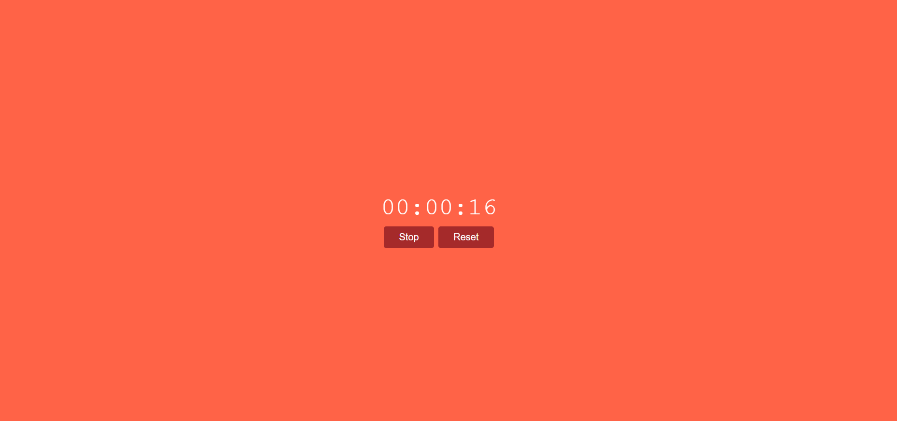

# ⏱️ Cronómetro Digital (Stopwatch)

Un cronómetro digital moderno y sencillo desarrollado con **HTML5**, **CSS3** y **JavaScript**. Permite medir el tiempo de forma precisa con funciones de inicio, parada y reinicio.

[](https://coddy.tech)


---

## 📝 Sobre este proyecto
Este código fue creado como un ejercicio de práctica dentro del curso de **Coddy**.

* **Plataforma:** [Coddy.tech](https://coddy.tech)
* **Objetivo:** Practicar lógica de programación y desarrollo de software.

---

## 🚀 Características

- **Control total:** Inicia, pausa y reinicia el tiempo con botones interactivos.
- **Formato estándar:** Visualización del tiempo en formato `HH:MM:SS` (Horas:Minutos:Segundos).
- **Diseño responsivo y estilizado:** Interfaz limpia centrada en pantalla con colores llamativos y efectos visuales (`hover`).
- **Código limpio:** Implementado sin dependencias externas, utilizando únicamente JavaScript nativo (Vanilla JS).

---

## 📂 Estructura del Proyecto

```text
├── index.html       # Estructura principal de la interfaz web
├── styles.css       # Estilos visuales y diseño del cronómetro
└── script.js        # Lógica del cronómetro y gestión de eventos
```

---

## 🛠️ Tecnologías Utilizadas

- HTML5 para la estructura de la aplicación.
- CSS3 para el diseño y la interfaz de usuario (Flexbox, efectos visuales).
- JavaScript (ES6+) para la lógica del tiempo (setInterval, manipulación del DOM y eventos).

---

## 💻 ¿Cómo ejecutar el proyecto localmente?

1. Clona este repositorio o descarga los archivos en tu computadora:

```text
git clone [https://github.com/Maicol843/Cronometro.git](https://github.com/Maicol843/Cronometro.git)
```

2. Abre el archivo index.html directamente en tu navegador web preferido.

---

<p align="center">
  
</p>

---

✨ Proyecto desarrollado como práctica de maquetación web, animaciones CSS y funciones JavaScript.
<p align="left">
  
  <b>Proyecto de Práctica | Realizado en <a href="https://coddy.tech/journeys/html/stopwatch__htmlcssjs_project">Coddy</a></b>
</p>
